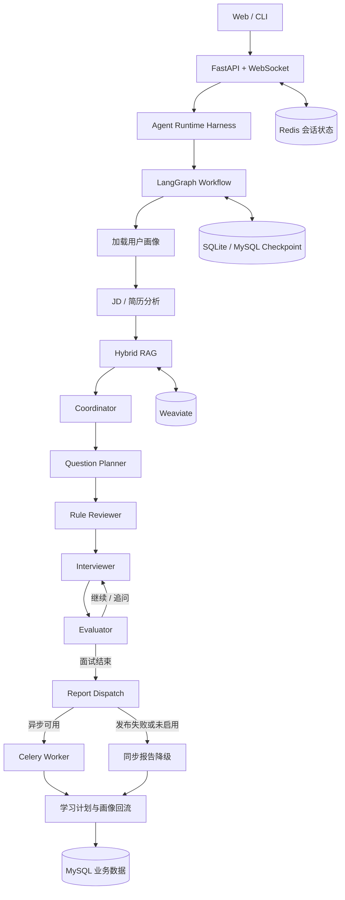

<div align="center">

# 🎯 InterviewAgent · 自适应多 Agent 模拟面试平台

**从岗位理解到能力成长：让每一次面试都能动态出题、持续追问、沉淀证据并反馈训练。**

根据 JD、简历与历史能力画像，自动完成岗位分析、知识检索、选题追问、回答评估、报告生成和学习规划。

</div>

---

## 🌟 项目简介

InterviewAgent 面向传统模拟面试题目固定、追问深度不足、面试结果难以沉淀的问题，构建了一套由 Coordinator 协调的多 Agent 工作流。系统不仅完成一次面试，还会把正式面试与练习产生的能力证据持续回流到用户画像，让后续选题和学习计划更贴近真实薄弱点。

### 为什么值得看

| 传统方案的问题 | InterviewAgent 的设计 | 带来的价值 |
| --- | --- | --- |
| 一次生成固定题单 | 基于岗位权重、知识缺口和能力置信度逐题决策 | 提升岗位匹配度与追问深度 |
| LLM 同时生成内容并控制流程 | LLM 负责生成与评分，确定性策略负责路由与选题 | 决策可解释、可回放、可测试 |
| 单路检索容易漏召回 | Weaviate + BM25 双路召回与自适应精排 | 兼顾语义匹配和技术关键词命中 |
| 长上下文直接堆入 Prompt | Context Budget + Manifest 约束证据范围 | 控制 Token 成本并减少无依据引用 |
| 报告生成阻塞主链路 | Celery 异步执行、进度推送、持久化恢复与同步降级 | 提升交互连续性和任务可靠性 |
| 面试结束后数据割裂 | 正式面试、错题复习、专项训练统一沉淀能力证据 | 形成面试—评估—训练闭环 |

## ✨ 核心技术亮点

- **Coordinator 多 Agent 协作**：LangGraph 负责编排整体流程，Coordinator 协调题目规划任务与审核结果采纳；共享 State 承载业务数据，任务板和 Artifact 记录协作过程，规则 Reviewer 审核候选题。
- **Agent Runtime Harness**：统一管理运行标识、执行预算、Checkpoint、OpenTelemetry Trace、输入信任边界、失败降级和 Bad Case 回放。
- **自适应面试决策**：将 LLM 内容生成、结构化评分与确定性路由解耦，根据岗位权重、知识缺口、能力置信度、覆盖度和题目区分度动态选题，支持澄清、深挖和挑战式追问。
- **Hybrid RAG**：Weaviate 向量召回与 BM25 关键词召回并行执行，经 Metadata Filter、加权 RRF 和内容指纹去重后，根据双路一致性、置信度与延迟预算决定是否调用 LLM Rerank。
- **分层记忆与训练闭环**：Redis 保存会话热状态，MySQL 沉淀正式面试与练习产生的能力证据，聚合用户知识点掌握度并回流后续选题。
- **可靠异步报告**：Celery 负责后台报告任务，MySQL 持久化任务状态，Redis Pub/Sub 传递进度事件，WebSocket 推送到前端；保留轮询恢复与同步生成降级。
- **工具治理与安全边界**：Tool Runtime 提供角色与工具权限、参数校验、超时重试、限流熔断、幂等控制和链路追踪，并可接入 MCP 工具适配器。
- **生产可观测性**：提供 liveness、startup、readiness 探针，Prometheus 兼容指标和初始 SLO 告警规则。

## 🏗️ 系统架构



### 组件职责

| 组件 | 职责 |
| --- | --- |
| LangGraph | 定义节点、条件边、循环和挂起点，驱动完整业务流程 |
| Coordinator | 协调题目规划阶段的任务依赖，并根据审核结果决定是否采纳 |
| Planner | 根据 JD、能力画像与入选 RAG 证据生成候选题 |
| Reviewer | 使用确定性规则检查重复度、岗位相关性、预期要点和证据范围 |
| Evaluator | 生成结构化评分，并更新问答记录与能力证据 |
| Harness | 统一执行预算、Checkpoint、Trace、降级和回归入口 |

State 是节点间的业务数据载体；任务板和 Artifact 位于 State 的协作区，用于记录任务状态、产物摘要、审核结果和事件，并随 Checkpoint 持久化。Artifact 聚焦协作审计，完整业务对象由 State 承载；Reviewer 直接审核候选题与入选证据范围。

## 🛡️ Agent Runtime Harness

Harness 为 LangGraph 外层提供统一运行约束：

- 使用 `run_id`、`thread_id` 和 `session_id` 串联请求、Checkpoint 与 Trace。
- 默认限制 30 个图步骤、12 次 LLM 调用、6 次工具调用、30000 Token 和 120 秒运行时间。
- LLM 单次请求默认超时 45 秒，节点异常可进入确定性降级路径。
- LangGraph Checkpointer 本地默认写入 `data/langgraph_checkpoints.sqlite3`，部署时可切换到共享 MySQL。
- OpenTelemetry 记录节点级 Span，并可选输出 JSONL Trace。
- Bad Case 回放验证已有 Trace 的确定性决策，不重新调用外部 LLM 或工具。
- 不可信 JD、简历和 RAG 内容在进入模型前进行边界标记，敏感字段在日志和错误响应中脱敏。

Checkpoint 在节点边界保存 State 和执行位置，不能从一次执行到一半的外部 LLM 或工具调用内部恢复。

## 🎚️ 自适应决策与上下文工程

系统不让 LLM 直接控制业务流转：LLM 负责生成题目和结构化语义评分，确定性代码负责选题、追问类型、能力更新和结束条件。

候选题优先级综合以下因素：

```text
岗位权重 + 知识缺口 + 能力不确定性 + 覆盖缺口 + 题目区分度
- 难度偏差 - 重复惩罚
```

主要机制：

- 每完成一道主问题后重新计算候选题优先级，而不是一次性固定整场题单。
- 根据结构化评分选择 `clarify`、`deepen`、`challenge` 或停止追问。
- 使用锚点题建立相对稳定的评分基线。
- 通过 IRT/Elo 风格残差更新能力值，降低动态难度变化造成的直接分数偏差。
- Context Budget 默认在 1800 Token 内筛选能力画像、薄弱点、最近问答和 RAG 证据。
- Context Manifest 记录上下文来源、信任等级、Token 成本和入选动作；只有入选 RAG 证据才能绑定到候选题。

项目内仿真实验中，技术点覆盖率提升 31%、深挖率提升 42%、评审一致率达到 90%；相关策略均保留确定性决策记录，便于复核和回归。

## 🔍 Hybrid RAG 与自适应精排

```text
                 ┌─ Weaviate 向量召回 ─┐
Query + Filter ──┤                     ├─ 加权 RRF ─ 指纹去重 ─ 自适应 Rerank ─ Top-K
                 └─ BM25 关键词召回 ───┘
```

### 检索流程

1. 从岗位、难度、知识点和用户数据范围构造 Metadata Filter。
2. Weaviate 与 BM25 并行召回，单路超时或失败时允许另一分支降级返回。
3. 使用内容指纹合并重复文档，并通过加权 RRF 融合不可直接比较的两路排名。
4. 根据分支健康度、Top 结果双路命中、排名一致性、结果数量和相对分差估计召回置信度。
5. 置信度不足且仍有延迟预算时调用 LLM Rerank；否则直接返回 RRF 结果。
6. Rerank 异常时回退到 RRF 排名，不中断面试链路。

安全过滤使用 `visibility` 和 `owner_id` 限制用户数据范围。Weaviate 尽量在服务端前置过滤，结果进入融合前还会由应用层再次校验。岗位和主题条件可以在结果不足时逐级放宽，权限条件不会放宽。

### 离线评测

最终报告：[`evals/reports/rag_adaptive_rerank_final.json`](evals/reports/rag_adaptive_rerank_final.json)

| 数据集 | Recall@5 | MRR | P95 |
| --- | ---: | ---: | ---: |
| 30 条离线检索集 | 96.67% | 85.11% | 9.43 秒 |

评测报告保留逐条召回结果、分支诊断和延迟数据，可直接复核指标口径；P95 同时反映当次外部向量服务与网络环境。

## 🧠 分层记忆与能力画像

系统采用“存储共享、用户隔离、上下文按角色裁剪”的记忆方式：

| 层级 | 存储 | 用途 |
| --- | --- | --- |
| 会话热状态 | Redis DB 0 | 当前会话、问答状态和断线恢复，默认 TTL 86400 秒 |
| 图执行状态 | SQLite / MySQL Checkpointer | LangGraph State 和节点执行位置 |
| 长期业务事实 | MySQL | 用户画像、面试记录、能力证据、练习记录和后台任务 |
| Tool Runtime 状态 | 内存 / Redis DB 3 | 幂等键、限流和熔断状态 |

正式面试与练习都会生成能力证据，练习证据通过权重和占比限制避免覆盖正式面试结论。项目内仿真实验中，训练画像回流后薄弱知识点得分提升 35%。

## ⚙️ 可靠异步报告链路

开启 Celery 后，报告链路如下：

```text
FastAPI 保存会话状态
  → 使用稳定任务 ID 与幂等键发布 Celery 任务
  → Worker 生成报告并更新 MySQL BackgroundTask
  → Redis Pub/Sub 发布阶段进度
  → FastAPI WebSocket 转发到浏览器
  → 前端低频轮询持久化状态作为断线恢复兜底
```

可靠性设计包括：

- Celery late ACK、Worker 丢失重投、`prefetch=1`、指数退避和软硬超时。
- MySQL 持久化任务状态、阶段、进度、重试次数和 Trace ID。
- Web 进程向 Worker 透传 W3C Trace Context。
- Broker 发布失败时自动降级为原同步报告生成。
- 会话状态缺失时记录 `retrying` 或 `failed`，避免任务静默消失。

默认使用 Redis Pub/Sub 提供低延迟进度事件，并通过 MySQL 任务状态与前端低频轮询补足断线恢复；同时提供 Redis Streams 可选传输，可按部署环境的 Redis 能力切换。

## 🔌 Tool Runtime 与 MCP

Tool Runtime 的调用顺序为：

```text
工具注册 → 角色权限与风险检查 → 参数 Schema 校验 → 执行预算
→ 幂等检查 → 限流/熔断 → 超时/重试 → Trace 与指标
```

`mcp/` 提供 MCP Client 和 GitHub、网页抓取工具示例；MCP 是外部工具接入协议，Tool Runtime 是权限、可靠性和可观测性治理层，两者职责不同。

## 📈 健康检查、指标与 SLO

### 健康探针

| 接口 | 语义 |
| --- | --- |
| `GET /health/live`、`/livez` | API 进程存活且事件循环可响应 |
| `GET /health/startup`、`/startupz` | FastAPI lifespan 已完成 |
| `GET /health/ready`、`/readyz` | MySQL、Redis、Weaviate 和按配置启用的 Celery 可用 |
| `GET /metrics` | Prometheus 文本格式指标 |

Readiness 并发检查依赖，默认单项超时 2 秒、缓存 5 秒。探针失败只影响是否承接新流量，不会移除业务已有的同步或内存降级路径。

### 关键指标

- 报告任务成功、失败、重试次数和执行耗时。
- Agent Run 成功率与耗时。
- Tool Runtime 成功率与调用耗时。
- LLM 调用结果及 Provider 实际返回的输入、输出 Token。
- MySQL、Redis、Weaviate 和 Celery readiness 状态。

P95 由 Prometheus 基于 Histogram 聚合，不在单进程中维护滑动窗口。指标标签不包含 `user_id`、`session_id`、`task_id` 或 `trace_id`，避免高基数。

### 初始 SLO

| SLI | 30 天初始目标 |
| --- | ---: |
| 必选依赖 readiness | 99.9% |
| 报告任务成功率 | ≥ 99% |
| 报告生成 P95 | ≤ 150 秒 |
| 重试次数 / 终态任务 | ≤ 5% |
| Tool Runtime 成功率 | ≥ 98% |
| Agent Run 成功率 | ≥ 99% |

这些是上线初期的工程目标，不是已经取得的生产数据。Prometheus 告警规则位于 [`deploy/prometheus/interviewagent_alerts.yml`](deploy/prometheus/interviewagent_alerts.yml)，完整说明见 [`docs/PRODUCTION_MONITORING.md`](docs/PRODUCTION_MONITORING.md)。

## 🚀 快速开始

### 1. 环境要求

- Python 3.10+
- MySQL 8.0+
- Redis 6.0+
- Weaviate
- 可用的 DashScope API Key

MySQL、Redis 与 Weaviate 均通过环境变量独立配置，可按开发、测试和部署环境连接对应服务。

### 2. 安装依赖

```powershell
conda create -n all-in-rag python=3.10 -y
conda activate all-in-rag
python -m pip install -r requirements.txt
```

### 3. 配置环境变量

```powershell
Copy-Item .env.example .env
```

至少需要修改：

```dotenv
DASHSCOPE_API_KEY=your_api_key
MYSQL_HOST=127.0.0.1
MYSQL_PORT=3306
MYSQL_USER=interview_agent
MYSQL_PASSWORD=your_password
MYSQL_DATABASE=interview_agent
REDIS_HOST=127.0.0.1
REDIS_PORT=6379
WEAVIATE_URL=http://127.0.0.1:8080
JWT_SECRET=replace_with_a_long_random_secret
```

`.env` 已加入 `.gitignore`，不要提交真实密钥。

### 4. 初始化数据库与索引

确保 MySQL、Redis 和 Weaviate 已启动，然后执行：

```powershell
python scripts/init_db.py
python scripts/build_index.py
```

知识库源文件位于 `rag/knowledge_base/knowledge/`。本地 BGE-M3 模型权重不随仓库提交，需要按所选 Embedding 方案单独准备。

### 5. 启动 Web 服务

```powershell
python -m uvicorn api.main:app --host 127.0.0.1 --port 8000
```

访问：

- Web 页面：<http://127.0.0.1:8000/>
- Swagger：<http://127.0.0.1:8000/docs>
- ReDoc：<http://127.0.0.1:8000/redoc>

### 6. 启用异步报告

在 `.env` 中配置：

```dotenv
CELERY_ENABLED=true
TASK_EVENT_STREAM_ENABLED=true
TASK_EVENT_TRANSPORT=pubsub
```

启动 Worker：

```powershell
python -m celery -A tasks.celery_app.celery_app worker --loglevel=INFO --pool=solo
```

API 和 Worker 需要同时运行。Worker 默认在 `9109` 端口暴露 Prometheus 指标。

### 7. 验证健康状态

```powershell
curl.exe http://127.0.0.1:8000/health/live
curl.exe http://127.0.0.1:8000/health/startup
curl.exe http://127.0.0.1:8000/health/ready
curl.exe http://127.0.0.1:8000/metrics
```

## 🧪 测试与离线评测

运行完整测试：

```powershell
python -m pytest -q
```

运行离线评测：

```powershell
python -m evals.run_offline rag `
  --dataset evals/datasets/rag_retrieval.expanded.jsonl `
  --mode full `
  --top-k 5 `
  --metadata-filter-from-tags `
  --thresholds evals/thresholds.example.json `
  --output evals/reports/rag_latest.json
```

相关说明：

- [`OFFLINE_EVAL.md`](OFFLINE_EVAL.md)
- [`ADAPTIVE_INTERVIEW.md`](ADAPTIVE_INTERVIEW.md)
- [`AGENT_RUNTIME.md`](AGENT_RUNTIME.md)
- [`TOOL_RUNTIME.md`](TOOL_RUNTIME.md)
- [`INTERVIEWAGENT_PROJECT_GUIDE.md`](INTERVIEWAGENT_PROJECT_GUIDE.md)

## 📂 项目结构

```text
InterviewAgent/
├── agents/                 # 内容生成、面试、评估和学习规划 Agent
├── api/                    # FastAPI、认证、业务接口与 WebSocket
├── audio/                  # Whisper STT、TTS 与音频管理
├── config/                 # 环境变量和日志配置
├── deploy/prometheus/      # Prometheus 告警规则
├── docs/                   # 生产监控等专题文档
├── evals/                  # 离线数据集、评测脚本与结果
├── frontend/               # Web 前端
├── mcp/                    # MCP Client 与工具适配器
├── memory/                 # Redis/MySQL 数据模型与 Repository
├── observability/          # Trace、指标和健康检查
├── orchestration/          # LangGraph、Harness、策略与协作机制
├── rag/                    # 索引、Metadata Filter、双路召回与 Rerank
├── skills/                 # 可插拔交互 Skill
├── tasks/                  # Celery 报告任务与进度事件总线
├── tool_runtime/           # 工具权限、可靠性与状态后端
└── tests/                  # 自动化测试
```

## 📌 工程设计说明

- **可切换状态后端**：本地开发可使用 SQLite Checkpointer，部署时可切换共享 MySQL，使不同 API 实例能够恢复同一 LangGraph 会话。
- **纵深数据隔离**：通过 `visibility`、`owner_id` 和服务端可信身份限定召回范围，并在融合前执行应用层二次校验。
- **多级可靠性兜底**：Redis Pub/Sub 负责实时进度，MySQL 保存任务事实，前端轮询负责恢复；Broker 异常时回退同步报告链路。
- **证据化工程评估**：RAG 指标保留完整离线报告，Agent 决策支持 Trace 与 Bad Case 回放，SLO 阈值与 Prometheus 告警规则独立配置。
- **低基数可观测性**：指标不写入用户、会话和任务 ID；LLM Token 只采用 Provider 返回的 usage，避免估算数据污染监控结果。
